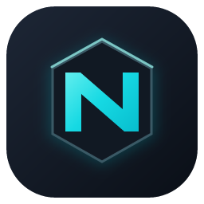

<div align="center">



# TidyBeam

**A fast, simple file manager for Windows, macOS and Linux.**
Everything runs on your computer — no account, no telemetry, no network.

[](https://github.com/singhshubham4422/TidyBeam/actions/workflows/ci.yml)
[](https://github.com/singhshubham4422/TidyBeam/releases)
[](LICENSE)


[**Download**](#download) · [Features](#features) · [Shortcuts](#keyboard-shortcuts) · [Build from source](#build-from-source) · [Contributing](CONTRIBUTING.md)

</div>

---

## Download

Get the latest version for your computer. All files are also listed on the [Releases page](https://github.com/singhshubham4422/TidyBeam/releases), together with `SHA256SUMS.txt` to verify them.

| | Intel / AMD (x64) | ARM64 |
|---|---|---|
| **Windows 10 / 11** | [Installer (.exe)](https://github.com/singhshubham4422/TidyBeam/releases/latest/download/TidyBeam-windows-x64-setup.exe) · [MSI](https://github.com/singhshubham4422/TidyBeam/releases/latest/download/TidyBeam-windows-x64.msi) | [Installer (.exe)](https://github.com/singhshubham4422/TidyBeam/releases/latest/download/TidyBeam-windows-arm64-setup.exe) |
| **macOS 10.15+** | [Intel (.dmg)](https://github.com/singhshubham4422/TidyBeam/releases/latest/download/TidyBeam-macos-x64.dmg) | [Apple silicon (.dmg)](https://github.com/singhshubham4422/TidyBeam/releases/latest/download/TidyBeam-macos-arm64.dmg) |
| **Linux** | [AppImage](https://github.com/singhshubham4422/TidyBeam/releases/latest/download/TidyBeam-linux-x64.AppImage) · [.deb](https://github.com/singhshubham4422/TidyBeam/releases/latest/download/TidyBeam-linux-x64.deb) · [.rpm](https://github.com/singhshubham4422/TidyBeam/releases/latest/download/TidyBeam-linux-x64.rpm) | [AppImage](https://github.com/singhshubham4422/TidyBeam/releases/latest/download/TidyBeam-linux-arm64.AppImage) · [.deb](https://github.com/singhshubham4422/TidyBeam/releases/latest/download/TidyBeam-linux-arm64.deb) · [.rpm](https://github.com/singhshubham4422/TidyBeam/releases/latest/download/TidyBeam-linux-arm64.rpm) |

TidyBeam will also be available from the **Microsoft Store**, which installs and updates it automatically.

> **Note:** the direct links point to the latest *stable* release. Beta versions appear only on the [Releases page](https://github.com/singhshubham4422/TidyBeam/releases).

<details>
<summary>Installing on Linux</summary>

```sh
# AppImage: make it executable and run it
chmod +x TidyBeam-linux-x64.AppImage && ./TidyBeam-linux-x64.AppImage

# Debian / Ubuntu
sudo apt install ./TidyBeam-linux-x64.deb

# Fedora / openSUSE
sudo dnf install ./TidyBeam-linux-x64.rpm
```
</details>

## Features

| | |
|---|---|
| **Browse** | Tabs with back/forward history, breadcrumbs you can click or type into, list and grid views with image thumbnails, favorites, drives, and a details panel with previews for images, text, video and audio. |
| **Move files safely** | Copy and move with Skip / Keep both / Replace, live progress, pause, resume and cancel. Deletes go to the Recycle Bin or Trash, and nothing is deleted permanently without asking. |
| **Dual pane** | Two folders side by side, transfers between them, and a quick folder comparison. |
| **Instant search** | Index the folders you choose, then find anything with **Ctrl/⌘ K**. Filters like `ext:pdf`, `size:>100mb`, `modified:week` and `type:folder`. The index stays on your device and keeps itself up to date. |
| **Tidy up** | Space analyzer, exact duplicate finder, and a review of old temporary files. |
| **Rules** | Move files by type and age, after a preview or automatically in the background. |
| **Archives** | Browse, create and extract ZIP files, with protection against unsafe or oversized archives. |
| **Your style** | Light and dark themes, four accent colors, and compact rows. |

## Keyboard shortcuts

| Action | Windows / Linux | macOS |
|---|---|---|
| Search everywhere | `Ctrl` `K` | `⌘` `K` |
| Type a location | `Ctrl` `L` | `⌘` `L` |
| Back / forward | `Alt` `←` / `Alt` `→` | `⌘` `[` / `⌘` `]` |
| Up one folder | `Alt` `↑` | `⌘` `↑` |
| New tab / close tab | `Ctrl` `T` / `Ctrl` `W` | `⌘` `T` / `⌘` `W` |
| New folder | `Ctrl` `Shift` `N` | `⌘` `⇧` `N` |
| Rename | `F2` | `F2` |
| Move to Recycle Bin / Trash | `Delete` | `⌘` `⌫` |
| Copy · cut · paste | `Ctrl` `C` · `X` · `V` | `⌘` `C` · `X` · `V` |
| Undo rename or new folder | `Ctrl` `Z` | `⌘` `Z` |
| Dual pane | `Ctrl` `\` | `⌘` `\` |

A system-wide search shortcut can be turned on in **Settings → Shortcuts**.

## Privacy

TidyBeam makes no network requests. Search indexes contain file names and details only, never file contents, and are stored in your local app-data folder. See [SECURITY.md](SECURITY.md) for the full security model.

## Build from source

You need [Node.js](https://nodejs.org) 20+, [Rust](https://rustup.rs) (stable), and the Tauri prerequisites for your OS:

- **Windows:** Microsoft C++ Build Tools and WebView2 (built into Windows 11).
- **macOS:** Xcode Command Line Tools — `xcode-select --install`.
- **Debian / Ubuntu:**
  ```sh
  sudo apt install libwebkit2gtk-4.1-dev build-essential curl wget file libxdo-dev libssl-dev libayatana-appindicator3-dev librsvg2-dev
  ```
  Other distributions: see the [Tauri prerequisites](https://tauri.app/start/prerequisites/).

```sh
git clone https://github.com/singhshubham4422/TidyBeam.git
cd TidyBeam
npm ci
npm run tauri dev      # run in development
npm run tauri build    # build installers for your OS (src-tauri/target/release/bundle)
npm run check          # type-check, build, rustfmt, clippy and tests
```

## Project docs

- [ARCHITECTURE.md](ARCHITECTURE.md) — how TidyBeam is built
- [CONTRIBUTING.md](CONTRIBUTING.md) — how to contribute
- [SECURITY.md](SECURITY.md) — reporting vulnerabilities
- [CHANGELOG.md](CHANGELOG.md) — what changed in each release
- [docs/microsoft-store.md](docs/microsoft-store.md) — publishing to the Microsoft Store

## License

[MIT](LICENSE) © 2026 Shubham
