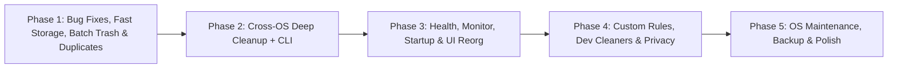

# TidyBeam — Cross-Platform Storage Optimization, Deep Cleanup & System Health Plan

> **Tagline:** *Clean storage, faster systems, effortless files — across Windows, macOS, and Linux.*  
> **Subtitle:** *Everything runs on your device — no account, no telemetry, no network.*

This plan defines how to evolve TidyBeam from a local-first cross-platform file manager into a unified **File Manager, High-Speed Storage Analyzer, Deep System & Privacy Cleaner, and System Health Suite** across **Windows 10/11 (x64 & ARM64), macOS 10.15+ (Intel & Apple Silicon), and Linux (x64 & ARM64)**.

---

## 1. Non-Negotiable Architecture & Policy Guardrails

Every feature in this plan must honor TidyBeam's existing contracts documented in [README.md](README.md), [ARCHITECTURE.md](ARCHITECTURE.md), [SECURITY.md](SECURITY.md), [PRIVACY.md](PRIVACY.md), [CONTRIBUTING.md](CONTRIBUTING.md), and [docs/microsoft-store.md](docs/microsoft-store.md):

1. **Zero network & zero telemetry by default:** TidyBeam makes no outbound network requests and runs no analytics or background phone-home update checks. Any feature touching software/OS updates (`winget`, `brew`, `apt`, `flatpak`, Windows Update) must be strictly user-initiated handoffs to OS-native tools/settings rather than TidyBeam fetching remote binaries or rule feeds.
2. **Recoverable deletion by default:** Cleanup, duplicates, and file actions default to the OS Recycle Bin / Trash via `platform::trash_one` and batched `trash::delete_all`. Permanent deletion, secure shredding, and free-space wiping require explicit user opt-in and confirmation, never silently bypassing `platform::is_protected`.
3. **Standard-user first & Microsoft Store MSIX compatibility:** TidyBeam runs as a `runFullTrust` standard-user desktop app (`packaging/msix/AppxManifest.xml`, targeting **`Windows.Desktop` only**—never Mobile, Xbox, Team, or Holographic AppContainer SKUs—and `windows.nsis.installMode = "currentUser"` in `src-tauri/tauri.conf.json`). Never run the WebView GUI elevated. Platform features requiring admin/root privileges must either gracefully hide/disable in sandboxed/Store distributions or run inside an explicit, short-lived, opt-in elevation helper (`UAC` / `osascript` / `pkexec`).
4. **Strict WebView security:** Keep the strict CSP in `src-tauri/tauri.conf.json`, load only bundled UI assets, never render file metadata/contents as raw HTML, and run all heavy I/O on Rust worker threads.
5. **Cross-OS first:** Every core capability must compile and pass `npm run check` (`tsc`, `vite build`, `cargo fmt --check`, `cargo clippy -- -D warnings`, `cargo test`) on Windows, macOS, and Linux in `.github/workflows/ci.yml`.
6. **Git & Release Discipline:** Never run `git push`, publish GitHub releases, or submit Store packages without explicit user permission.

---

## 2. Target Architecture

To keep the GUI, scheduled background runs, and CLI cleanly aligned without code duplication, split the backend into a shared Rust workspace library (`tidybeam-core`) consumed by both the Tauri app (`src-tauri`) and a companion CLI (`tidybeam-cli`).

```text
┌───────────────────────────────────────────────────────────────────────────┐
│ React + TypeScript UI (src/)                                              │
│  Files Workspace  │  Storage & Clean  │  System & Boost  │  Automate      │
│  Command Palette  │  Unified Activity Tray  │  Optional Compact Mini Bar  │
└────────────────────────────────────┬──────────────────────────────────────┘
                                     │ Tauri IPC (invoke + events)
┌────────────────────────────────────┴──────────────────────────────────────┐
│ Tauri App Layer (src-tauri/src/lib.rs) + Companion CLI (tidybeam-cli)     │
│  Capability Discovery (OS, Arch, IsElevated, IsMsix, SupportedFeatures)   │
└────────────────────────────────────┬──────────────────────────────────────┘
                                     │
┌────────────────────────────────────┴──────────────────────────────────────┐
│ Shared Core (tidybeam-core)                                               │
│  ├── storage_engine   u32 arena cache, drive-aware rayon, OS bulk-stat    │
│  ├── duplicate_engine 4 KiB -> 32 KiB -> SIMD blake3 + SQLite hash cache  │
│  ├── cleaner_engine   Parallel rules, batch trash, stage-and-drop, sqlite │
│  ├── shredder         Safe wipe + SSD/CoW warnings + free-space fill      │
│  ├── system_monitor   sysinfo CPU/RAM/Process/Net/Hardware + battery      │
│  ├── os_adapters      #[cfg(windows | macos | linux)] Startup/Trash/Apps  │
│  ├── scheduler        In-app timers + Task Scheduler / launchd / systemd  │
│  └── audit_log        Local SQLite history of scans, cleanups, & boosts   │
└───────────────────────────────────────────────────────────────────────────┘
```

### Capability Discovery Contract

Extend `platform_info` (`src-tauri/src/lib.rs`) to return structured platform flags so the UI adapts seamlessly across OSes and packaging modes:

- `os`: `"windows" | "macos" | "linux"`
- `isElevated`: boolean
- `isPackagedStore`: boolean (detect MSIX package identity on Windows / sandbox constraints)
- `capabilities`: feature flags (e.g., `registryClean`, `packageManagerClean`, `smartDiskHealth`, `tempSensors`, `nativeScheduler`, `emptyWorkingSet`, `freeSpaceWipe`)

---

## 3. Rocket-Speed Storage, Cleanup & Duplicate Engine

### Current Bottlenecks Identified

Inspecting `src-tauri/src/analysis.rs`, `src-tauri/src/lib.rs`, `src/views/StorageView.tsx`, `src/views/CleanupViews.tsx`, and `src/App.tsx` reveals why scanning and deleting currently feel slow:

1. **Single-threaded consumer aggregation:** `analysis::analyze` configures `jwalk` with `2..=8` threads for `read_dir`, but consumes every entry sequentially in one loop (`for item in ParallelWalkDir...`), allocating `item.path()`, calling `strip_prefix(root)` + allocating another `PathBuf`, hashing into a `HashMap`, and calling `item.metadata()` sequentially.
2. **Rescans every time Storage (or Cleanup/Duplicates) is clicked:** `src/App.tsx:569` unmounts `<StorageView />` on view switch, `src/views/StorageView.tsx:33` fires `useEffect(() => { run(path); }, [path])` unconditionally on every mount, and `StorageView.tsx:74` triggers a full re-walk on every subfolder click (`DuplicatesView` and `CleanupView` repeat this pattern on mount).
3. **Fixed worker pool across SSD and HDD:** `workers` (`2..=8`) runs identically on NVMe SSDs and mechanical HDDs/USB drives, causing head thrashing on spinning disks while under-utilizing fast NVMe queues.
4. **No scan cancellation or live partial breakdown:** Starting a new scan only drops stale replies in React (`scanId.current`), leaving orphaned Rust walks running; `analysis-progress` emits only counts with no folder totals until 100% completion.
5. **Ignores existing search index & repeats identical work:** `IndexDb` (`search-index.sqlite3`) already tracks live-watched roots `(path, is_dir, size, modified)`, yet Storage skips it completely.
6. **Serial cleanup scan & per-item shell trash calls:** `analysis::cleanup_candidates` walks roots serially via `WalkDir`; `trash_paths` calls `platform::trash_one` one path at a time instead of batching; `analysis::duplicates` walks single-threaded and seeks both head and tail before a quick head check.
7. **Unvirtualized Cleanup & Duplicate UI lists:** Unlike `FileList.tsx` (which uses `@tanstack/react-virtual` + 200-row paging), `CleanupViews.tsx` renders every row directly into the DOM and sends full item arrays across IPC at once.

### 3.1 Storage Scan Engine & Caching (All OSes, Zero Admin Required)

1. **Eliminate Unnecessary Re-Scans on View Click (`StorageView` + `AnalysisSnapshots`)**
   - Keep `StorageView` cached/mounted (or restore immediately from Rust `AnalysisSnapshots` via a fast `get_cached_analysis(root)` call on mount before ever starting a disk walk).
   - Never auto-rescan an already-cached folder just because the user clicked **Storage** in the sidebar—show the cached breakdown immediately with a `"Last scanned X ago"` badge and an explicit **Rescan** (dirty-subtree refresh) button, only scanning automatically when opening an uncached folder.

2. **Flat `u32` Arena Tree + LRU/TTL Cache (`AnalysisSnapshots`)**
   - Build a compact arena (`Vec<DirNode>` indexed by `u32` parent/child IDs with `self_bytes`, `allocated_bytes`, `total_bytes`, `file_count`, `folder_count`, `mtime`, and bounded top-N heap).
   - Store `OsStr` names only where needed (nodes and winning top-N files) and convert to UTF-8 strings lazily only for IPC slices—cutting RAM ~10× on million-file trees and removing cross-thread allocator contention.
   - Cache trees in managed Rust state (`AnalysisSnapshots`, patterned after `DirectorySnapshots` in `src-tauri/src/listing.rs`) so drill-downs, up-navigation, and tool switches take **< 1 ms**.

3. **Drive-Aware Concurrency (`sysinfo::Disks`) & Background Thread Priority**
   - Query `sysinfo::Disks` (`kind()` / `is_removable()`) for the target volume: cap **HDD and removable drives at 1–2 workers** to prevent disk-head thrashing while scaling **NVMe/SSD volumes to 8–12 workers**.
   - Run scanner workers at lowered OS scheduling priority (`BelowNormal` on Windows, `nice`/`IOPRIO_CLASS_IDLE` on Unix) so the UI and other apps stay responsive.

4. **Incremental Dirty-Subtree Rescans (`notify`) + SQLite Cold-Start Cache**
   - Attach a lightweight `notify` watcher (or reuse active `IndexWatchers`) to scanned roots so modified subfolders are marked **dirty**. Clicking **Rescan** re-walks only dirty subtrees rather than the whole drive.
   - Persist compact `(root, folder_path, total_bytes, allocated_bytes, file_count, mtime)` summaries in local SQLite so Storage renders a warm layout immediately on cold open while re-validating only changed `mtime` folders in the background.

5. **OS-Native Standard-User Fast Stat Paths**
   - **Windows:** Call `FindFirstFileExW` with `FindExInfoBasic` (skips legacy 8.3 short-name lookups) and `FIND_FIRST_EX_LARGE_FETCH` (larger kernel buffer) to read names, attributes, and sizes in bulk without opening per-file handles—100% compatible with standard user rights and Microsoft Store MSIX.
   - **macOS:** Use `getattrlistbulk(2)` (macOS 10.10+, matching `minimumSystemVersion: "10.15"`) to retrieve entry names, types, logical sizes, and allocated blocks in bulk kernel calls instead of `readdir` + N `lstat` syscalls.
   - **Linux:** Use `openat` + `getdents64` + `statx` relative to open directory file descriptors (`AT_SYMLINK_NOFOLLOW`), avoiding repeated full-path kernel VFS resolution on deep trees like `node_modules`.

6. **Cloud Placeholder Safety, Physical Allocation, Hardlinks & Mount Guards**
   - Detect Windows cloud/reparse flags (`FILE_ATTRIBUTE_RECALL_ON_DATA_ACCESS`) and macOS dataless files before sizing/opening so OneDrive / iCloud Drive scans never trigger network hydration or downloads.
   - Record both **Logical Size** and **On-Disk Size** (`st_blocks * 512` on Unix; `FILE_STANDARD_INFO::AllocationSize` / `GetCompressedFileSizeW` + sparse checks on Windows).
   - Deduplicate hardlinks (`(dev, ino)` on Unix / file index on Windows when link count > 1) so hardlinked stores (`pnpm`, WinSxS, APFS clones) count once.
   - Skip virtual/pseudo/loop filesystems (`/proc`, `/sys`, `/dev`, `/run` outside removable media, APFS snapshots/firmlink loops) and support a "Stay on same drive/filesystem" (`one-file-system`) toggle.

7. **Cooperative Cancellation, Streaming Deltas & `IndexDb` Baseline**
   - Register an `Arc<AtomicBool>` cancel flag per `scanId` in `AnalysisTasks` (matching `TransferTasks` in `src-tauri/src/lib.rs`) so leaving `StorageView`, clicking another folder, or hitting Cancel halts worker threads within milliseconds.
   - Emit progressive top-level child totals and top-largest candidates every 250 ms.
   - When scanning inside a live-watched `IndexDb` root, compute an instant preliminary tree from SQLite while verifying physical sizes in the background.
   - *(Optional non-MSIX Windows enhancement, deferred)*: An opt-in elevated NTFS `$MFT` / USN helper can scan local NTFS drives in ~1–3 s, kept strictly secondary to the universal fast engine above.

### 3.2 Rocket-Fast Cleanup & Trash Execution

1. **Batched OS Trash (`trash::delete_all`):** Update `trash_paths` in `src-tauri/src/lib.rs` to submit all confirmed paths in a single `trash::delete_all` batch (`IFileOperation` on Windows, batch Trash on macOS/Linux) instead of looping `trash_one` per path—cutting multi-thousand-file cleanup from tens of seconds to sub-second. Fall back to binary split / per-item only if a locked file causes a batch error.
2. **Parallel Permanent Delete + Instant Stage-and-Drop:** For permanent cleaning of huge small-file trees (`node_modules`, browser cache shards), rename whole folders atomically into a local staging folder on the same volume (**~1 ms** instant UI completion) and unlink leaf files in parallel across `rayon` threads in the background before removing empty dirs bottom-up.
3. **Parallel Cleaner Discovery + Category-by-Category Streaming:** Fan out all enabled cleaner rules in parallel (`rayon`), prune missing app paths via cheap `metadata().is_dir()` checks, and stream each category (`System Temp` in `< 20 ms`) over IPC as soon as it finishes.
4. **Idle Startup Pre-Scan Warmup:** After startup settles (alongside `index::restore` in `src-tauri/src/lib.rs`), run a low-priority background pass for lightweight user temp and browser cache totals so opening **Cleanup** or **Boost** renders ready totals immediately.

### 3.3 High-Speed Duplicate Finder

1. **Parallel Size Grouping:** Replace single-threaded `WalkDir` in `analysis::duplicates` with the parallel drive-aware directory walker.
2. **3-Tier Hashing Funnel:** Add a **4 KiB head-only `xxh3` pass** before the 16+16 KiB head+tail pass—eliminating ~95%+ of non-duplicates in one sequential read without seeking to file ends.
3. **SIMD `blake3` + SQLite Large-File Hash Cache:** Use multi-threaded SIMD `blake3` (with SHA-256 display/compat option) for multi-GB videos/ISOs, and cache `(path, size, mtime, hash)` in SQLite for files `> 10 MB` so repeat scans skip unchanged large files.

### 3.4 Frontend & IPC Speed (`FileList.tsx` Parity)

1. **Virtualize Cleanup & Duplicate Lists:** Apply `@tanstack/react-virtual` (already in `package.json`) to `CleanupViews.tsx` and `DuplicatesView` so rendering 50,000+ detected items stays locked at 60/120 fps.
2. **Summary-First + Lazy Paged IPC:** Keep matched path arrays in Rust session state, stream only compact category totals initially, and fetch per-file paths with `offset`/`limit` only when a user expands a cleaner group.
3. **Non-Blocking Progress:** Route long cleanups, scans, and shreds into the unified Activity Tray (`Tray.tsx`) rather than blocking view switches with a full-page `busy` lock.

---

## 4. Comprehensive Cross-Platform Feature Specification

Below is the complete implementation plan covering **System & Privacy Cleaning**, **Performance & Health Maintenance**, **Hardware & Diagnostics**, and **Extra Value-Adding Features**—explicitly mapped across **Windows**, **macOS**, and **Linux** with privilege and Store rules noted.

### 4.1 System, Browser & Application Deep Cleaning

| Feature Area | Implementation Strategy | Windows | macOS | Linux | Privileges / Notes |
|---|---|---|---|---|---|
| **System Temp, Caches & Logs** | Data-driven TOML/JSON cleaner definitions resolving OS path templates (`%LOCALAPPDATA%`, `~/Library/Caches`, `$XDG_CACHE_HOME`, `/tmp` UID-checked) | User temp, WER reports, crash dumps, thumbnail cache (`thumbcache_*.db`), Windows logs (opt-in) | User `~/Library/Caches`, `~/Library/Logs`, diagnostic reports, saved state | `~/.cache`, `~/.xsession-errors*`, `/tmp` user-owned, thumbnail cache | Standard user for user paths; `C:\Windows\Temp` & `/var/log` require opt-in elevation |
| **Trash / Recycle Bin Empty** | Native Trash purge command with preview of size/items | `SHEmptyRecycleBinW` | Empty `~/.Trash` / Finder Trash (check FDA) | Empty `$XDG_DATA_HOME/Trash` (and mounted `.Trash-$UID`) | Explicit confirmation required |
| **Clipboard & Recent Documents** | Clear clipboard (`arboard` / Tauri plugin) & OS recent item lists | Clear clipboard, Recent items (`%APPDATA%\Microsoft\Windows\Recent`), Run MRU | Clear clipboard, Finder/app recents (within user scope) | Clear clipboard, `~/.local/share/recently-used.xbel`, broken `.desktop` links | Standard user |
| **Scattered Junk & Backups** | Pattern sweepers with dry-run preview | `Thumbs.db`, `desktop.ini` (guarded), `*.tmp`, `*.bak`, `*.old` | `.DS_Store`, `._*` AppleDouble files, `*.tmp`, `*.bak` | `*~`, `*.bak`, broken symlinks | Safe Trash-first mode |
| **Browsers (Chrome, Edge, Brave, Opera, Vivaldi, Firefox, Safari)** | Profile discovery across native, Flatpak, and Snap paths; lock detection via `sysinfo` before modifying open profiles | All Chromium & Gecko families + legacy Edge caches | Chrome, Firefox, Edge, Brave, Opera; Safari requires Full Disk Access prompt | Native + `.var/app/*` (Flatpak) + `~/snap/*` (Snap) | Warns & optionally closes running browser before cleaning locked files |
| **Granular Browser Data & SQLite Vacuum** | Direct SQLite cleaning & `VACUUM` + `PRAGMA wal_checkpoint(TRUNCATE)` using bundled `rusqlite` | Cache, cookies (with domain whitelist), history, downloads, sessions, form history, site storage, crash dumps, Chrome/Firefox DB vacuum & selective Firefox URL deletion | Same | Same | Whitelist preserves login cookies for pinned domains |
| **Application Cleaners** | Built-in rules for VLC, LibreOffice, VS Code, Discord, Slack, Spotify, Steam, OBS, GIMP, etc. | Cache, logs, recents, temp files, crash dumps, app DBs | Same | Same | Extensible via JSON/CleanerML |
| **Package & Localization Cleaners** | Subprocess adapters for `apt`, `dnf`, `pacman`, `zypper`, `flatpak`, `journalctl`; locale file pruning | N/A | Homebrew cache (`brew cleanup`) | Package caches, unused Flatpak runtimes, journal vacuum, `/usr/share/locale` whitelist | Root ops run via `pkexec`; user Flatpak/Brew needs no root |

### 4.2 Privacy, Security & Secure Sanitization

1. **Privacy Trace Sanitization & Privacy Dashboard:** Unified view aggregating browser trackers, cookies, recent file lists, clipboard contents, application history, telemetry/diagnostic deep-links to OS Privacy Settings, and SQLite sanitization (`VACUUM` + `PRAGMA secure_delete = ON`).
2. **Secure File & Folder Shredding:** Multi-pass or NIST-style random + zero overwrite (`O_SYNC`/`sync_all`) followed by filename randomization and deletion, available from Cleanup, Duplicates, and file context menus.
3. **Free Disk Space Wiping:** Writes temporary zero/random-filled files up to remaining free space (excluding a configurable safety reserve so the OS stays responsive), cleans MFT/directory free entries where supported, then deletes them.
   - **Mandatory Accuracy & Safety Notice:** Explicitly warn users in UI and docs that **SSDs (wear-leveling / over-provisioning)** and **copy-on-write filesystems (APFS, Btrfs, ZFS)** or **Windows Shadow Copies** prevent guaranteed physical block erasure; recommend **full-disk encryption (BitLocker / FileVault / LUKS)** as primary protection.
4. **Windows Registry History Cleaning (Windows-Only, Non-Store / Opt-In):** Scoped strictly to safe user history keys (MRU lists, orphaned uninstall pointers, dead shell associations)—never aggressive system registry cleaning—with automatic `.reg` backup export before modification.

### 4.3 Custom Cleaners, CleanerML, `winapp2.ini` & CLI Automation

1. **CleanerML & `winapp2.ini` Engine:**
   - Parse open **CleanerML** XML definitions and community **`winapp2.ini`** INI rules locally (imported from user-selected local files, keeping zero-network intact).
   - Map `winapp2.ini` environment variables cross-OS where applicable, ignore Windows-only registry verbs on macOS/Linux, and tag entries with OS compatibility.
2. **Custom Cleaner Builder & Whitelist Manager:**
   - Visual rule builder (paths, globs, regex, min-age days, SQLite vacuum target, Expert Mode toggle) plus global path/folder/cookie domain whitelists.
   - Always preview exact matched files and byte totals before deletion.
3. **Companion CLI (`tidybeam-cli`) & Native Scheduling:**
   - Commands: `list`, `preview`, `clean`, `analyze`, `duplicates`, `rules run`, `--preset`, `--json`, `--debug-log`, `--dry-run`.
   - Native Scheduler registration: **Windows Task Scheduler** (`schtasks` / COM XML), **macOS `launchd`** (`~/Library/LaunchAgents/*.plist`), and **Linux `systemd --user` timers / `cron`**.
   - **Portable Mode:** Non-Store Windows `.zip` and Linux `AppImage` store config/index/audit DB alongside the executable when a `.portable` marker file is present.

### 4.4 Performance Boost, Health Check, Startup, Processes & Apps

1. **One-Click Health Check:** Unified scan across five domains:
   - *Junk & Browser Caches*
   - *Large & Duplicate Files + Cluttered Downloads*
   - *Startup Impact*
   - *System & Disk Health*
   - *OS Security & Update Posture*
   - Displays every suggested fix with clear checkboxes and impact estimates—one click applies only reviewed items.
2. **Boost & Intelligent Acceleration:**
   - Reclaims temp junk + identifies high-RAM idle background apps for safe user-confirmed closing across all OSes.
   - On Windows, optionally offers safe `EmptyWorkingSet` trim with clear explanation of standby vs physical RAM freeing.
   - **Intelligent Acceleration:** Background threshold monitor (configurable RAM % or temp-size threshold, polling via `sysinfo`) that runs safe, pre-approved temp cleanup or notifies the user—respecting TidyBeam's opt-in automation rules pattern (`rules.rs`).
   - *(Note on Linux memory/swap drop: `/proc/sys/vm/drop_caches` & swap reset strictly gated behind Expert Mode + `pkexec` with performance warning).*
3. **Startup Manager (Cross-OS Adapters):**
   - **Windows:** `HKCU\...\Run`, `HKCU\...\RunOnce`, user Startup folder, User Task Scheduler triggers (plus read-only view / elevated toggle for `HKLM\...\Run`).
   - **macOS:** `~/Library/LaunchAgents/*.plist` (enable/disable via `launchctl` + plist inspection) and guidance/deep-link for Login Items (`SMAppService`).
   - **Linux:** `~/.config/autostart/*.desktop` (`Hidden=true`/`X-GNOME-Autostart-enabled=false`) and `systemctl --user list-unit-files`.
4. **Process Manager:**
   - Powered by `sysinfo` (already in `Cargo.toml`): real-time CPU%, RAM, Disk I/O (where available), parent/child tree, and running path.
   - Protects critical system processes (`System`, `csrss.exe`, `lsass.exe`, `launchd`, `WindowServer`, `systemd`, `init`, etc.) from termination and warns before stopping unsaved apps.
5. **Application Manager & Leftover Finder:**
   - Lists installed user apps (`Uninstall` registry keys + MSIX/Appx on Windows; `/Applications` + `~/Applications` `.app` bundles on macOS; `.desktop` / `flatpak` / `snap` / `dpkg` / `rpm` inventory on Linux).
   - Triggers native uninstallers or trashes `.app` bundles, then runs a **Safe Leftover Scan** for orphaned folders in `AppData`, `~/Library/Application Support|Caches|Preferences`, and `~/.config|~/.local/share` with explicit user review.

### 4.5 OS Maintenance, Security Links & System Monitoring Suite

| Feature | Cross-OS Approach | Offline / Store / Privilege Handling |
|---|---|---|
| **Real-Time CPU, RAM, Hardware Specs** | Live dashboard via `sysinfo` (per-core CPU, memory/swap breakdown, OS/kernel/CPU/RAM/motherboard/GPU info) | 100% cross-OS, zero admin, offline |
| **Network Activity Monitor** | Per-interface upload/download throughput & totals via `sysinfo::Networks` | Standard user; optional elevated per-process socket view via OS tools (`netstat`/`lsof`/IPHelper) |
| **Battery Health & Power Report** | Cross-OS battery crate (`starship-battery` / OS APIs) showing design capacity vs full-charge capacity, wear %, cycle count, power draw | Standard user on Windows/macOS/Linux laptops |
| **Temperature Monitoring** | `sysinfo::Components` on Linux (`hwmon`/thermal) + IOKit/SMC read-only on macOS + WMI ACPI thermal zones on Windows | Explicitly omit ring-0 kernel drivers on Windows to keep Microsoft Store certification and system security intact |
| **Disk Health & SMART** | Windows `MSFT_PhysicalDisk` ReliabilityCounters (WMI), macOS `diskutil`/IOKit SMART status, Linux `udisks2` DBus / `smartctl` (if installed) | Standard user for basic status/wear indicators; detailed NVMe SMART attributes via optional elevation |
| **Security, Firewall & OS Updates** | Read-only security posture checks + one-click OS deep-links (Windows Security / Firewall / Windows Update `ms-settings:`; macOS FileVault / Gatekeeper / Software Update; Linux `ufw`/`firewalld` & update manager) | Never acts as an independent AV engine; optionally invokes Windows Defender CLI (`MpCmdRun.exe`) or `clamscan` if installed |
| **System Repair & Toolbox** | Icon/thumbnail cache rebuild, Explorer/Dock/Shell restart, DNS cache flush, quick launcher shortcuts (Screenshot, Calculator, Terminal, Clock, Notepad/TextEdit) + optional compact Mini Toolbar | Wayland limits always-on-top window positioning gracefully; Windows default-app reset opens `ms-settings:defaultapps` cleanly |
| **Noisy App & Notification Audit** *(replaces Pop-up Blocker)* | Instead of brittle third-party window hooking, audits background/tray/autostart apps and links to OS Focus / Notification Settings | Fully Store-compliant & cross-OS |
| **User Backup & Restore Points** | **Cross-OS Incremental Folder Backup** built on `transfer.rs` + `archive.rs` (versioned ZIP or mirror backup to external drives) + read-only links/status for Windows Restore Points, macOS Time Machine, and Linux Timeshift | User folder backups run completely offline as standard user |
| **Software & Driver Inventory** | Local inventory of installed apps/versions/drivers; optional **user-triggered** handoff to OS package managers (`winget`, `brew`, `fwupdmgr`, `apt`) | Preserves TidyBeam's zero-network default while giving power users an easy update button |

---

## 5. Extra Value-Adding Features (Unique to TidyBeam)

These features leverage TidyBeam's dual strength as a fast file manager and system utility:

1. **Developer & Creator Bloat Cleaner:** Dedicated scanner for heavy dev/creative caches—inactive `node_modules` (only flagging projects untouched for `> N` days so active repos stay intact), Rust `target/`, Python `.venv` / `__pycache__` / `pip`, `Cargo` / `npm` / `pnpm` / `gradle` / `maven` caches, Xcode `DerivedData` & old iOS simulators, Docker/WSL unused cache hints, and video editor render caches.
2. **Downloaded Installer & Extracted Archive Cleanup:** Identifies `.exe`, `.msi`, `.dmg`, `.pkg`, `.deb`, `.rpm`, `.iso`, and `.zip` files in `Downloads` older than `N` days (or matching already-extracted folders) and integrates directly with TidyBeam's **Organize Rules**.
3. **Empty Folder & Broken Link Sweeper:** Finds zero-file nested directories and dangling symlinks/shortcuts across any selected folder.
4. **Storage Growth Timeline ("What filled my disk?"):** Stores lightweight per-scan folder snapshots in local SQLite so users can compare today vs last week/month and immediately see which directory grew by gigabytes.
5. **Visual Burst/Similar Photo Detection:** Optional perceptual-hash similarity mode inside `DuplicatesView` alongside exact byte-for-byte duplicates, showing side-by-side image previews with EXIF resolution/size before trashing.
6. **Smart Rule-Based Auto-Clean:** Extends `src-tauri/src/rules.rs` with safe age-based trash rules (e.g., *"Move `.dmg`/`.exe` installers in Downloads older than 30 days to Trash"*) plus a filterable **Cleanup & Recovery Audit Log**.

---

## 6. UI & UX Improvement Plan

All UI upgrades build directly on the existing design system in `src/styles.css` (custom properties, `--row`, `--radius`, `--accent-soft`, `--success`/`--warning`/`--danger`, responsive `< 960px` rail collapse, and `prefers-reduced-motion`).

### 6.1 Information Architecture & Navigation (`Sidebar.tsx`)

Expanding from 6 flat tool entries to 12+ maintenance features would overcrowd the sidebar. Restructure the sidebar into **4 clean workspaces** backed by top segmented pills (`.seg`) inside each view:

| Sidebar Item | Sub-tabs Inside Workspace |
|---|---|
| **Files** *(Places, Favorites, Drives stay pinned above)* | File Browser (Tabs + Dual Pane) · Instant Search Index |
| **Storage & Clean** | **Health Overview** · **Deep Clean** · **Space Analyzer** · **Duplicates** · **Dev & Large Files** |
| **System & Boost** | **Live Monitor** · **Startup Apps** · **Processes** · **Installed Apps** · **Hardware, Battery & Disk** · **OS Tools & Privacy** |
| **Automate** | **Organize & Clean Rules** · **Schedules** · **Custom Cleaners** · **History Log** |

### 6.2 Space Analyzer UI Upgrades (`StorageView.tsx`)

- **Interactive Treemap + Folder Bar Toggle:** Add a switch between the current clean horizontal breakdown bar/list and an interactive zoomable **Treemap** (colored by category or top folder) with hover tooltips.
- **Instant Breadcrumb Drill-Down & Back/Forward:** Clicking a folder drills straight into the cached tree in `< 1 ms` with an inline breadcrumb path inside `StorageView`, plus `Open in Files tab` and `Move to Trash` row actions. Preserve scan state across workspace switches in `App.tsx` so clicking **Storage** never restarts finished scans.
- **Live Scan Hydration:** Render top-level folder bars and largest files live as scan progress events arrive, with a prominent **Cancel** button and `"Last scanned …"` freshness indicator.
- **Category Breakdown Chips:** Show space split by *Media*, *Archives*, *Code/Dev*, *Documents*, *App Data*, and *Other*, plus a toggle between **On-Disk Size** and **Logical Size**.

### 6.3 Deep Cleanup & Health Check UI (`CleanupViews.tsx`)

- **Health Check Launch Card:** Clean 5-pillar diagnostic card with status pills (`Good`, `Review`, `Attention`), reclaimed-space estimate, and an expandable fix list before clicking **Apply Selected Fixes**.
- **Virtualized Grouped Accordion Checklist:** Organize cleanup items into expandable categories (*System*, *Browsers*, *Apps*, *Developer*, *Privacy Traces*) rendered via `@tanstack/react-virtual` + paged IPC details, with per-category totals, instant search filter, and an expandable **Preview Files** drawer.
- **Explicit Safety Badges:** Every cleaner item shows a semantic pill:
  - `Safe` (cache/temp, moves to Trash)
  - `Session Reset` (warns that cookies/sessions will sign out websites)
  - `App Open` (warns that Chrome/Firefox must close or be skipped)
  - `Permanent / Shred` (red danger badge matching `--danger`)
- **Sticky Action Bar:** Anchors at the bottom of `CleanupView` showing selected count, bytes to free, deletion mode (`Trash` / `Permanent` / `Shred`), and `Preview` / `Clean Now` buttons without blocking browsing.

### 6.4 Live System Monitor, Startup & Process Views

- **Clean Metric Cards & Sparklines:** Lightweight SVG sparklines for CPU %, Memory pressure, Disk I/O, and Network up/down using `--chart-1..4` tokens (zero heavy chart libraries needed).
- **One-Click Boost Header Pill:** Top-bar quick summary badge (`RAM 68% · 2.4 GB junk`) backed by idle background warmup, opening a compact popover for **1-Click Boost** and **Toolbox** shortcuts without leaving the active file tab.
- **Optional Mini Floating Bar & System Tray:** Opt-in compact widget (via Tauri window/tray APIs) with CPU/RAM gauge, Quick Boost, Screenshot, and Clipboard Wipe—automatically hiding multi-screen positioning controls on Linux Wayland sessions where global window placement is restricted.

### 6.5 Command Palette (`Palette.tsx`) & Unified Activity Tray (`Tray.tsx`)

- **Action + Search Command Palette (`Ctrl/⌘ + K`):** Keep instant file search as default while prefixing `>` (or quick action chips) lets power users run `> Clean browser caches`, `> Analyze current folder`, `> Boost memory`, `> Vacuum SQLite DBs`, or `> Run Health Check`.
- **Unified Activity Drawer (`Tray.tsx`):** Combine file transfers, active storage/duplicate/cleanup/shred jobs, scheduled rule runs, and recent cleanup undo/summaries in one unified bottom-right drawer with pause, cancel, and history tabs.

---

## 7. Phased Implementation Roadmap



### Phase 1 — Codebase Bug Fixes, Rocket-Speed Storage, Batch Trash & Duplicates
- Fix all high-priority codebase bugs identified in **Section 9** (Storage/Cleanup rescan-on-click, `trash()` partial-failure return bug, `paste()` cut-clipboard loss on conflict cancel, path prefix/case-sensitivity guards, `FileList` select-all/range selection, thumbnail downscaling, double `path_size` walk on rename, and `safe_output` duplicate canonicalization).
- Refactor `src-tauri/src/analysis.rs` into a drive-aware (`sysinfo::Disks` SSD vs HDD concurrency) `rayon` walker building a flat `u32` arena tree (`AnalysisSnapshots`), with OS standard-user bulk-stat paths (`FindFirstFileExW`, `getattrlistbulk`, `openat`/`getdents64`/`statx`), cloud-placeholder/hardlink/mount guards, and `AtomicBool` scan cancellation.
- Add `notify` dirty-subtree invalidation, SQLite cold-start folder summaries, streaming `analysis-progress` folder deltas, and `IndexDb` instant baselines + smart unchanged-row skipping on startup refresh.
- Upgrade `trash_paths` (`src-tauri/src/lib.rs`) to batched `trash::delete_all` with per-item fallback; add parallel leaf unlink + instant stage-and-drop for confirmed permanent folder deletes.
- Speed up `analysis::duplicates` with parallel walk + 4 KiB head-only pre-check + SIMD `blake3` + SQLite large-file hash cache.
- Upgrade `StorageView.tsx` (preserve state across tool switches, instant drill-downs, Storage breadcrumbs, Treemap view, Cancel button) and virtualize `DuplicatesView` via `@tanstack/react-virtual`.

### Phase 2 — Cross-OS Deep Cleanup Engine, Browser/SQLite Optimization & CLI
- Create `tidybeam-core` workspace crate + `tidybeam-cli` binary.
- Ship built-in declarative cleaner catalog with parallel rule discovery, category-by-category IPC streaming, and idle startup warmup (System temp/logs/dumps, Recycle Bin/Trash empty, Clipboard clear, Chrome/Edge/Firefox/Brave/Opera/Safari profiles, VLC/LibreOffice/VS Code/Discord, scattered junk).
- Implement `sysinfo` running-process lock checks and `rusqlite` `VACUUM` + selective Firefox URL history pruning + cookie domain whitelisting.
- Upgrade `CleanupViews.tsx` with virtualized grouped accordions, lazy paged file-preview drawers, safety badges, and sticky non-blocking action bar.

### Phase 3 — UI Workspace Consolidation, Health Check, Monitor, Startup & Processes
- Reorganize `Sidebar.tsx` into the 4 clean workspaces (`Files`, `Storage & Clean`, `System & Boost`, `Automate`) and evolve `Tray.tsx` + `Palette.tsx`.
- Build **Live Monitor** (CPU, RAM, Disk I/O, Network, Hardware Info, Battery Health) using `sysinfo` and battery APIs.
- Build **Startup Manager** and **Process Manager** across Windows, macOS, and Linux.
- Build **Health Check** and **One-Click Boost / Intelligent Acceleration** combining junk, startup, duplicates, and storage checks.

### Phase 4 — Advanced Cleaning, Developer Bloat & Privacy Tools
- Add **Developer & Creator Bloat Cleaner** (`node_modules`, `target/`, `.venv`, package caches) and **Old Installer Sweeper** tied to `rules.rs`.
- Add **CleanerML** XML and **`winapp2.ini`** local file importers + Custom Cleaner Builder + Whitelist UI.
- Add **Secure File/Folder Shredder** and **Free-Space Wipe** with mandatory SSD/APFS/Btrfs warnings and confirmation workflows.
- Add **Native Scheduler Integration** (Task Scheduler / `launchd` / `systemd --user` & `cron`) + **Storage Growth Snapshots** + **Audit Log**.

### Phase 5 — App Management, OS Maintenance, Backup & Release Hardening
- Add **Application Manager & Leftover Scanner** (native uninstall handoff + orphaned data review).
- Add **Disk SMART / Health**, **Cross-OS User Folder Backup** (built on `transfer.rs` + `archive.rs`), **Privacy Dashboard**, **Toolbox / Mini Toolbar**, and OS maintenance shortcuts (Windows Defender/Update/Taskbar/Registry history opt-in, macOS/Linux package & maintenance helpers).
- Align `README.md`, `PRIVACY.md`, `SECURITY.md`, `ARCHITECTURE.md`, and Store descriptions per [publish.md](publish.md) (keeping MSIX `runFullTrust` `Windows.Desktop` compliance intact).

---

## 8. Verification & Quality Matrix

Every phase must pass automated validation before merging:

1. **Workspace Check:** `npm run check` (`tsc`, `vite build`, `cargo fmt --check`, `cargo clippy --all-targets -- -D warnings`, `cargo test`).
2. **Safety & Regression Rust Tests (per [CONTRIBUTING.md](CONTRIBUTING.md)):**
   - Storage analyzer tests verifying hardlink deduplication, symlink non-traversal, sparse/allocated byte accounting, dirty-subtree invalidation, cancellation mid-scan, and cached subtree consistency.
   - Cleaner & trash tests verifying `is_protected` guards, batched `delete_all` fallback on locked files, whitelist preservation, dry-run accuracy, UID checks in shared `/tmp`, SQLite lock rejection when locked, and Trash-first behavior.
   - Duplicate tests verifying 4 KiB head pre-filter -> head+tail -> full hash consistency and SQLite hash cache invalidation on `mtime`/size change.
   - Transfer, index, and archive tests verifying cancel during pre-size, `IN_ROOT` case/boundary correctness, `remove_root` enclosing checks, and Unix read-only timestamp preservation.
   - Shredder tests verifying overwrite-before-unlink inside isolated temp dirs without following symlinks.
   - Startup adapter tests mocking/targeting temporary user autostart directories on each OS.
3. **Cross-OS CI Matrix (`.github/workflows/ci.yml`):** Full check + `cargo deny` + `npm audit --omit=dev` on `windows-latest`, `macos-latest`, and `ubuntu-22.04`.
4. **Store & Packaging Validation (`.github/workflows/store.yml` & `release.yml`):** Verify x64 & ARM64 bundles on Windows (NSIS/MSI + `Windows.Desktop` MSIX bundle), macOS (`.dmg`), and Linux (`AppImage`, `.deb`, `.rpm`), confirming privileged features are cleanly gated out or flagged in standard-user MSIX builds.

---

## 9. Codebase Bug Audit & Optimization Backlog

Every issue below was verified directly in the current codebase and must be resolved during implementation:

| # | Severity | Location | Observed Bug / Optimization Issue | Planned Fix |
|---|---|---|---|---|
| 1 | **High** | `src/App.tsx:569`, `src/views/StorageView.tsx:24-33,74`, `src/views/CleanupViews.tsx:14-18,70-74` | **Re-scans on every Storage/Cleanup click:** Switching tools unmounts `StorageView`/`DuplicatesView`/`CleanupView`; returning re-runs full disk walks unconditionally, and clicking a Storage folder re-walks from scratch without cancelling the prior Rust scan. | Keep scan state cached across tab switches (`AnalysisSnapshots` + React cache), cancel superseded Rust tasks via `AtomicBool`, and only re-scan when stale or explicitly requested. |
| 2 | **High** | `src/App.tsx:213-234`, `src/views/CleanupViews.tsx:20-24,78-81` | **False deletion success in `trash()` fallback:** When `trash_paths` fails on an item and the user clicks **Keep** in the permanent-delete confirmation dialog, `trash()` still returns `true`, causing `DuplicatesView.keepNewest` to remove un-deleted items from the UI. | Return structured outcome (`deletedCount`, `keptFailed`) from `trash()` so UI removes only confirmed deleted paths. |
| 3 | **High** | `src/App.tsx:307-311` | **Cut clipboard wiped before conflict resolution:** `paste()` clears `clipboard` immediately after `beginTransfer` opens `ConflictDialog`; cancelling the conflict dialog loses the cut items. | Clear `clipboard` only when `startTransfer` actually dispatches the move. |
| 4 | **High** | `src/components/FileList.tsx:122-129,152-156` | **`Ctrl+A` & `Shift+Click` miss unloaded rows:** `Ctrl+A` iterates `Object.values(data.pages).flat()` and range selection loops over `entryAt(i)`, skipping rows outside loaded 200-item pages in large folders. | Add a backend command (or fetch missing range/all paths from `DirectorySnapshots`) when `Ctrl+A` or cross-page `Shift+Click` occurs. |
| 5 | **Medium** | `src/components/Sidebar.tsx:23-25`, `src/views/SearchView.tsx:55`, `src-tauri/src/index.rs:223,276` | **Path prefix boundary & case-sensitivity bugs:** `.startsWith()` without a path separator matches sibling folders (`/mnt/usb` vs `/mnt/usb-backup`, `C:\Users\dev` vs `C:\Users\dev2`), `index.rs:276` `substr()` matches sibling prefixes in `remove_root`, and `index.rs:223` uses case-sensitive `Path::starts_with` on Windows/macOS. | Use separator-aware, OS-case-normalized containment checks (`same_or_descendant` logic) in both UI and SQLite queries (`remove_root` + `apply_changes`). |
| 6 | **Medium** | `src-tauri/src/lib.rs:542-545`, `src-tauri/src/transfer.rs:234-238,302-315,376-380` | **Double `path_size` walk & uncancellable prep + Unix read-only `copy_times`:** `start_transfer` walks all sources in `path_size` without checking `TaskControl::cancelled`, same-drive `move_item` (`fs::rename`) walks `target` a second time, and small read-only files (`<= 16 MiB`) fail `copy_times` after `fs::copy` preserves read-only permissions on Unix. | Pass `TaskControl` cancel check into `path_size`, reuse computed `total_bytes` on `fs::rename`, and set timestamps before read-only permission bits on Unix. |
| 7 | **Medium** | `src-tauri/src/index.rs:167-217,416-439` | **Startup re-index rewrites unchanged rows:** `index_root` runs single-threaded `WalkDir` and executes `ON CONFLICT DO UPDATE` + FTS5 triggers for every file on startup even when `(size, modified)` are unchanged. | Compare existing `(size, modified)` or update `generation` cleanly without firing FTS5 updates on unchanged names. |
| 8 | **Medium** | `src-tauri/src/archive.rs:170-198` | **Duplicate `safe_output` canonicalization in ZIP extract:** `extract()` calls `safe_output(&root, relative)` twice per entry (running `symlink_metadata` + `canonical` on every ancestor component twice). | Cache verified directory components per extraction and pass the already-validated output path from preflight into the extraction loop. |
| 9 | **Medium** | `src/components/FileList.tsx:9,240` | **Full-resolution grid image decoding:** Grid thumbnails load raw images up to 40 MB directly via `assetUrl`, exhausting WebView GPU memory on large photo folders. | Serve downscaled cached thumbnails (e.g. 256 px WebP/JPEG via local cache or OS shell thumbnail API) for Grid View. |
| 10 | **Low** | `src/App.tsx:150-154` | **Window focus refreshes inactive File Browser:** Returning focus to TidyBeam fires `refresh()` (`force: true`) even when viewing Storage, Cleanup, Rules, or Settings. | Defer `force: true` folder listing refresh until `view === "files"` is active (or mark stale). |
